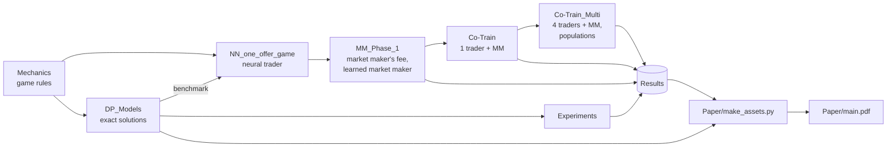

# Market Breakdown under Adverse Selection in a Multi-Agent FX Dealer Market

Code, saved runs and paper for a research project at the University of Bath, Department of Mathematical Sciences, supervised by Dr Avi Mayorcas (June–October 2026).

**Paper:** [`Paper/main.pdf`](Paper/main.pdf) (40 pages)

## The question

A classroom foreign-exchange game sets four traders, who must convert currency to meet targets, against a market maker who sees the exchange rate the traders cannot. A Bureau de Change is everyone's fallback. What makes the market maker match the traders against each other rather than hedge everything at the Bureau?

## Main findings

All assume one offer per trader per round.

- **The market maker's fee is a change of units.** The game with trader fee $f$ and market-maker fee $g$ is the game without the market maker's fee at trader fee $f'=(f-g)/(1-g)$. To leading order, the ratio $\rho = f' a_0/\sigma$ (the fee a fill can save, against one step of the rate) sets what a blind offer is worth.
- **At the game's fees the offer channel breaks down.** $\rho = 0.253$, the best blind offer fills 0.06% of the time, and the policy found by dynamic programming gains less than one basis point of capital over converting everything at the Bureau in round 1.
- **With four learning traders, netting needs a wide spread.** Trained together, four traders and a market maker trade at a fee spread of 1.5% but not at 1%. Even then the market maker nets little, because blind quotes fill in opposite tails of the rate.

The multi-agent results rest on single training runs and are indicative (see the paper's Limitations).

## How the project fits together



## Repository map

| Folder | What it contains | Paper |
|---|---|---|
| [`Mechanics/`](Mechanics) | `fx_mechanics.py`: the game's rules (trade rates, Bureau payoffs, market-maker acceptance), shared by every model | §3 |
| [`DP_Models/`](DP_Models) | Exact single-trader solutions. `v0_game.py`: one blind offer, closed form. `v1_sequential_offers.py`: several offers per round. `v2_multiple_rounds.py`: the full four-round game by dynamic programming | §4, App. B, C |
| [`NN_one_offer_game/`](NN_one_offer_game) | `rl_env.py`: the game as a Gymnasium environment. `torch_train.py`: neural trader trained by direct policy optimisation through a differentiable simulator. `PPO_train.py`: model-free baseline. `rl_diagnostics.py`: shared evaluation | §6, §7.1 |
| [`MM_Phase_1/`](MM_Phase_1) | The market maker's own Bureau fee. `fee_aware_v0.py`: closed form with the fee. `torch_train_fee.py` / `train_traders.py`: traders against a fee-aware market maker. `mm_train.py`: a learned market maker against frozen traders | §5, §7.1–7.2 |
| [`Co-Train/`](Co-Train) | `cotrain.py`: one trader and one market maker trained against each other. `negative_paths.py`: how often the rate path goes negative | §7.3 |
| [`Co-Train_Multi/`](Co-Train_Multi) | `cotrain_multi.py`: four traders (or a random population) and one market maker trained together. `run_arms.py`: runs the matrix in parallel. `spread_ladder.py`: fee spreads 1–6%. `robustness_runs.py`, `more_tables.py`: seeds and schedule checks. `verify_population.py`, `replay_check.py`: audits of the saved runs. `redo_numbers.py`: reads the saved runs (used by the paper). Remaining scripts draw figures and tables from saved runs | §6.4–6.5, §7.4–7.7, App. E–G |
| [`Experiments/`](Experiments) | `fee_aware_dp.py`: the full game with the market maker's fee, DP next to the networks. `MM_fee_experiment.py`: sweep over the market maker's fee. `v0_sigma_sweep.py`: one-offer result against volatility. `Random_init_experiment/`: trader trained across random markets | §5.5, §7.1 |
| [`Paper/`](Paper) | `main.tex` / `main.pdf`: the paper. `make_assets.py`: rebuilds every number (`numbers.tex`), table and figure from the code and the saved runs. `make_run_figures.py`: the learning-curve figures. `cache/`: cached solves and run readings | all |
| [`Results/`](Results) | Saved runs: trained weights, training curves, evaluation records, plots. See [`Results/README.md`](Results/README.md) | all |

## Reproducing the paper

```
pip install -r requirements.txt
python Paper/make_assets.py --only figures   # numbers, tables and figures from the cached readings in Paper/cache
python Paper/make_assets.py                  # full rebuild: re-solves the models and re-reads every saved run
python Paper/make_run_figures.py             # the learning-curve figures
```

Nothing is retrained. `Paper/cache/` holds the dynamic-programming solves and every number read from the saved runs, so the first command works from a fresh clone. The full rebuild and `make_run_figures.py` also read the full evaluation records (`cotrain_multi_eval.npz`, 200,000 paths per run). They are too large for GitHub (up to 415 MB each, 4.1 GB in total) and are available on request.

To retrain a model, run its script directly; each file's header lists its settings. Training scripts write to `Results/` under the folder names described in `Results/README.md`.

Tested with Python 3.13 on macOS (CPU only).

## Author

Yassir Hakim, BSc Computer Science and Mathematics, University of Bath. I thank Dr Avi Mayorcas for supervising the project, for the question that framed it, and for his guidance throughout.
